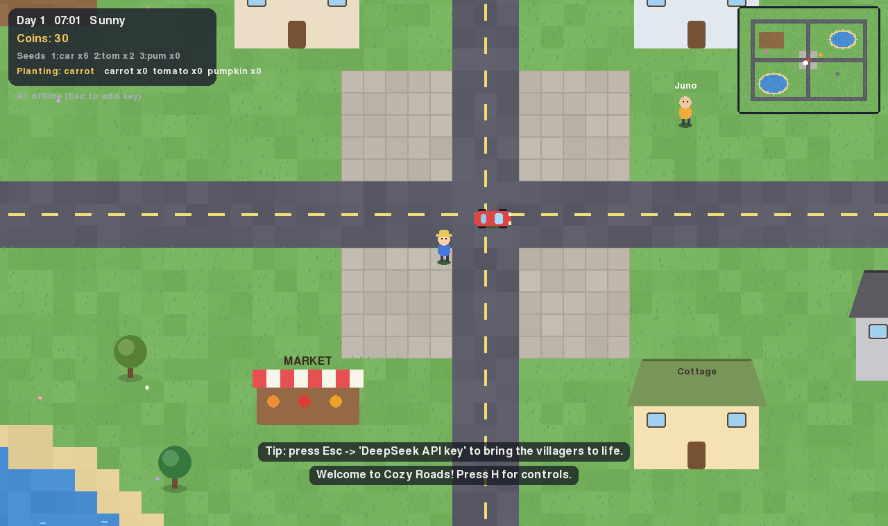
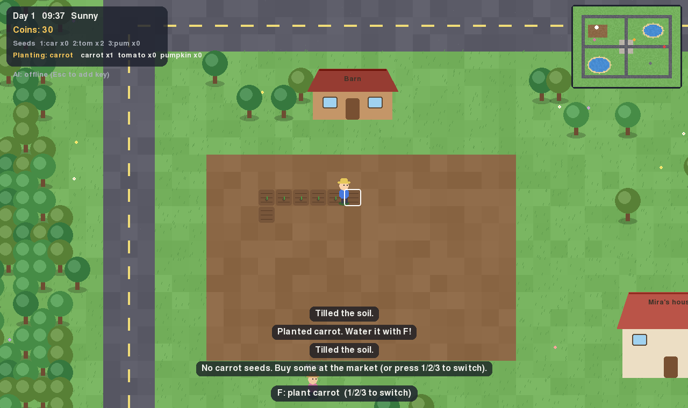
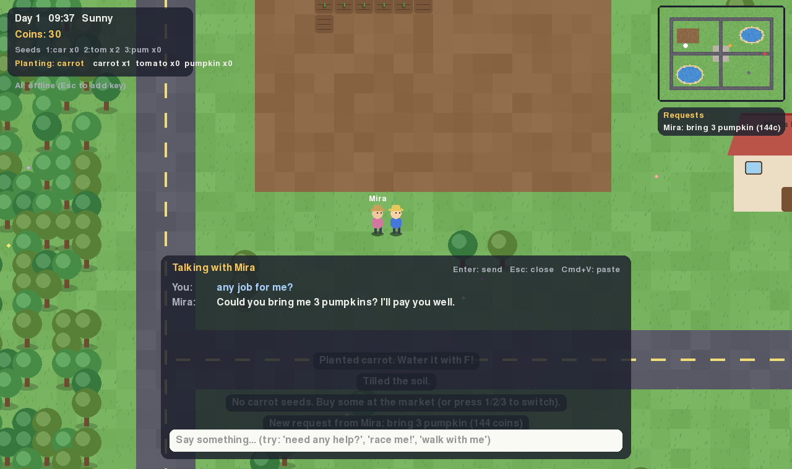

# Cozy Roads 🚗🌱

A chill, open-world macOS game: walk, run, drive the ring road, grow crops, and
hang out with villagers who are powered by **DeepSeek AI**. They chat back,
remember you, give you requests and gifts, challenge you to races, and walk
around the village with you.

It's a real native app (`Cozy Roads.app`), not a web page.



## What you can do

| Activity | How |
|---|---|
| Walk / run | WASD or arrow keys, hold **Shift** to run |
| Drive | Walk to the red car, press **E**. W/S = gas/brake, A/D = steer. Faster on roads. |
| Farm | In the field west of the village, press **F**: till → plant → water → harvest. **1/2/3** picks carrot/tomato/pumpkin seeds. Water once per growth stage (rain waters for you). |
| Market | Press **E** at the market stall to buy seeds and sell crops |
| Talk to villagers | Walk up to Mira, Ben or Juno and press **T** |
| Pause / settings | **Esc** (set your DeepSeek key here). **H** = controls, **F11** = fullscreen |

There's a day/night cycle (one day = 8 minutes), random rain, and autosave.



## The AI villagers

With a DeepSeek key, each villager has their own personality and sees the game
state (time, weather, your inventory, open requests). While chatting they can:

- **give you a request** ("bring me 3 tomatoes") with a coin reward
- **gift** you seeds or a few coins
- **challenge you to a race** to a place on the map, with a timer
- **walk somewhere** or **walk with you**
- greet you when you pass by

Try saying things like *"need any help?"*, *"race me!"*, *"walk with me to the pond"*.
Everything the AI asks for is validated and capped by the game (no infinite coins).

Without a key the game still works with simple offline lines.



### Adding your DeepSeek key

In the game: **Esc → DeepSeek API key**, paste with **Cmd+V**, press **Enter**.
It tests the connection right away. The key is stored only on your Mac at
`~/Library/Application Support/CozyRoads/settings.json` (file permissions 600).
Alternatively set the `DEEPSEEK_API_KEY` environment variable.

Never commit your key to this repository.

## Getting the app

### Option A: download the build (no setup)

Every push builds the app on GitHub's Mac machines. Open the repo's
**Actions** tab → latest **Build macOS app** run → download
**CozyRoads-macOS** → unzip → drag **Cozy Roads.app** into Applications.
(The automatic build is for Apple Silicon Macs; on an Intel Mac use option B.)

Because it isn't signed by Apple, the first time **right-click the app → Open**
(or System Settings → Privacy & Security → *Open Anyway*).

### Option B: build it yourself

Needs Python 3.10+ (`brew install python` if you don't have it):

```bash
git clone <this repo> && cd GameAI
./build_mac.sh
open "dist/Cozy Roads.app"
```

### Option C: just run it

```bash
python3 -m venv .venv && source .venv/bin/activate
pip install -r requirements.txt
python run_game.py
```

## Project layout

```
run_game.py            entry point
cozyroads/game.py      game loop, UI, chat, quests, shop, day/night, weather
cozyroads/world.py     map generation and rendering (all art is drawn in code)
cozyroads/entities.py  player, car physics, villagers, farm
cozyroads/ai.py        DeepSeek client (background threads) + offline fallback
cozyroads/settings.py  settings / save file locations
build_mac.sh           builds "Cozy Roads.app" with PyInstaller
tools/make_icon.py     generates the app icon
```

Save data lives in `~/Library/Application Support/CozyRoads/save.json`; delete it to start over.
